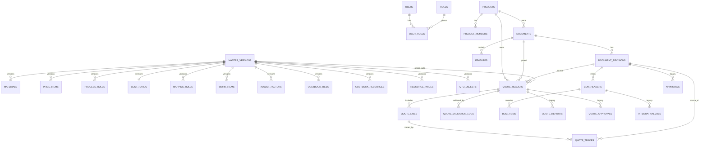

# AX-CAD 정보구조도 (IA) V1.2

> **V1.2 (2026-11-09)**: SCR-21(언더레이 패널), 마이그레이션 0025~0028(조립·판금·견적 도면 구분·`underlay_files`), `needs_quote` 컬럼 반영.

> 7단계 개발 절차 중 **3단계 산출물**. 기능명세서(FN)를 메뉴·화면·데이터 구조로 배치한다.
> 근거: `P-Design-System`(네비게이션 구조, 워크벤치), `P-개발참조1·2`(화면 목록, DDL), `P-견적산정-확장2`(견적 ERD), `DESIGN.md`.
> **V1.1 (2026-11-02)**: 구현된 화면·경로·테이블(마이그레이션 0001~0028)로 갱신했다. 설계 당시 화면 번호(SCR-xx)는 바꾸지 않고, 폐지·통합·신규를 표시했다. PC 설치본(Track 7)에는 로그인과 승인함이 없다.

## 1. 사이트맵 (구현 기준)

```text
AX-CAD
├── 로그인 (/login)                              ── 서버 모드만 (PC 모드는 로그인 없음)
├── 홈 (/)                                        ── 내 프로젝트 카드(최근 생성순)
├── 프로젝트 (/projects)
│   └── 프로젝트 상세 (/projects/[projectId])     ── 도면 목록·새 도면(업로드 / 빈 도면 / 3D 모델부터)
├── 캐드 메뉴 (/cad)                              ── 프로젝트 없이 새 도면 작성·DXF/DWG 열기 (홈에도 표시)
├── 도면 상세·개정 이력 (/documents/[documentId]) ── 리비전 목록, 견적 목록("3D 모델로 견적"), BOM 링크
│   ├── 워크벤치: 2D Draft (/viewer/[revisionId]) ── 뷰어·작도·편집·측정·PDF 출력·견적 메트릭·공사 견적
│   ├── 워크벤치: 3D Model (/model/[documentId]) ── 스케치·Feature 트리·직접 선택·측정·"도면 만들기"
│   └── BOM (/documents/[documentId]/bom)         ── CSV/JSON, "ERP 업로드 파일(Excel)"
├── 견적 빌더 (/quotes/[quoteId])                  ── 워크벤치: Quote (라인·요약·시나리오·검증·추적·견적서 출력)
└── 관리 (/admin)
    ├── 기준정보 (/admin/master-data)              ── G1 가져오기·버전·재질·공정·단가·공종·품셈·보정
    ├── 사용자 (/admin/users)                      ── 서버 모드만
    ├── 감사 로그 (/admin/audit)
    └── 업데이트 (/admin/updates)                  ── PC 설치본 관리자: R 표기·변경 내역·패치 적용·결과
```

> 💡 FreeCAD처럼 **워크벤치(작업 모드)**를 상단 탭으로 전환한다: `Draft | Model | Quote`. 같은 도면 컨텍스트를 유지한 채 모드만 바뀐다(`DESIGN.md` §1).
>
> **주 메뉴**(`AppShell`): 홈 · 프로젝트 · 사용자(서버 모드 ADMIN) · 기준정보(ESTIMATOR 이상) · 감사 로그(REVIEWER 이상) · 업데이트(PC 모드 ADMIN). 설계 당시의 `승인함`, `연동 작업 모니터링`, 견적 목록·견적서 미리보기 별도 화면은 없다.

## 2. 화면 목록

| ID | 화면명 | 경로(URL) | 접근 권한 | 주요 기능(FN) | 릴리스 | 상태 |
|---|---|---|---|---|---|---|
| SCR-01 | 로그인 | `/login` | 전체(비로그인) | FN-25 | R1 | 서버 모드만 |
| SCR-02 | 홈 | `/` | 로그인(PC 모드: 항상) | 내 프로젝트 | R1 | 구현 (할 일·승인 대기 영역은 없음) |
| SCR-03 | 프로젝트 목록 | `/projects` | 로그인 | FN-08 | R1 | 구현 |
| SCR-04 | 프로젝트 상세(도면 목록) | `/projects/[projectId]` | 프로젝트 멤버 | FN-08, FN-01 업로드, 빈 도면 | R1 | 구현 (경로가 `/projects/[id]/documents`가 아닌 `/projects/[id]`) |
| SCR-05 | 도면 상세·개정 이력 | `/documents/[documentId]` | 프로젝트 멤버 | FN-09, 견적 목록(SCR-08 흡수), BOM 링크 | R1 | 구현 (승인 요청 제거) |
| SCR-06 | 2D Draft 워크벤치 | `/viewer/[revisionId]` | 조회: 멤버 / 편집: DESIGNER | FN-02~07, FN-14 견적 메트릭, 공사 견적 | R1 | 구현·확장 |
| SCR-07 | 3D Model 워크벤치 | `/model/[documentId]` | 조회: 멤버 / 편집: DESIGNER | FN-10~13, FN-15, FN-07 도면 만들기 | R2 | 구현·확장 |
| SCR-08 | 견적 요청 목록 | (SCR-05 안) | 프로젝트 멤버 | 견적 검색·생성 | R3 | **통합**: 별도 화면 없이 도면 상세의 "견적" 영역 |
| SCR-09 | 견적 빌더(Quote 워크벤치) | `/quotes/[quoteId]` | ESTIMATOR(편집), 그 외 조회 | FN-17~21 | R3 | 구현·확장 (공사 견적·시나리오) |
| SCR-10 | 견적 추적 드로어 | SCR-09 내 오버레이 | 견적 조회 권한 | FN-18 | R3 | 구현 |
| SCR-11 | 견적서 미리보기·출력 | (SCR-09 내) | ESTIMATOR | FN-21 | R3 | **통합**: PDF·Excel 내려받기(내부용 산출근거 선택) |
| ~~SCR-12~~ | ~~승인함~~ | ~~`/approvals`~~ | | FN-22 | R1·R3 | **폐지** (Track 7) |
| ~~SCR-13~~ | ~~승인 상세~~ | ~~`/approvals/[id]`~~ | | FN-22 | R1·R3 | **폐지** (Track 7) |
| SCR-14 | BOM | `/documents/[documentId]/bom` | DESIGNER, MANUFACTURING | FN-23, FN-24 | R4 | 구현 (ERP 전송 → ERP 업로드 파일) |
| SCR-15 | 사용자·권한 관리 | `/admin/users` | ADMIN | FN-25 | R1 | 서버 모드만 |
| SCR-16 | 기준정보 관리 | `/admin/master-data` | ADMIN(편집), ESTIMATOR(조회) | FN-16 | R3 | 구현 (버전 선택 + 섹션으로 이어진 단일 화면, 하위 경로 없음) |
| ~~SCR-17~~ | ~~연동 작업 모니터링~~ | ~~`/admin/integrations`~~ | | FN-24 | R4 | **폐지** (Track 7, ERP 실연동 제거) |
| SCR-18 | 감사 로그 | `/admin/audit` | ADMIN, REVIEWER | FN-26 | R1 | 구현 |
| SCR-19 | 업데이트 | `/admin/updates` | PC 모드 관리자 | FN-25 (Track 8 P5) | R1.0 | **신규** |
| SCR-20 | 캐드 메뉴 | `/cad` (홈에도 같은 카드) | 모든 구성원(DESIGNER+) | FN-08·FN-10 | R1.0 | **신규**: 프로젝트 없이 새 도면 작성(용지 선택 → 작도 화면) 또는 DXF·DWG 열기(뷰어). 도면은 공용 "빠른 도면" 프로젝트(`QUICK-CAD`)에 보관 |
| SCR-21 | 언더레이 패널 | `/viewer/[revisionId]` 내 패널 | DESIGNER+ | FN-28 | 2026-11 | **신규**: 부착·페이지·정렬·클립·가져오기 |

화면 안 대화상자(별도 SCR 번호 없음): 뷰어의 **견적 메트릭 · 공사 견적 · PDF 출력 · 레이어 · 블록**, 모델 화면의 **스케치 · 구멍 마법사 · 3D 측정 · 도면 만들기(`DrawingDialog`)**.

## 3. 화면 간 이동 경로 (Navigation Flow)

```text
[홈 SCR-02] → [프로젝트 목록 SCR-03] → [프로젝트 상세 SCR-04] ─┬→ [도면 상세 SCR-05] ─┬→ [2D Draft SCR-06] ⇄ [3D Model SCR-07]   (워크벤치 탭)
                                                              │                      ├→ "견적" 영역 → [견적 빌더 SCR-09]
                                                              │                      └→ [BOM SCR-14] → ERP 업로드 파일(Excel) 내려받기
                                                              └→ (새 도면: 업로드 / 빈 도면 / 3D 모델부터)
[SCR-06] 견적 메트릭 · 공사 견적 → [견적 빌더 SCR-09] ─┬→ [추적 드로어 SCR-10] → (원천 도면 하이라이트 SCR-06/07)
[SCR-07] 도면 만들기 → 새 도면 리비전(DXF) → [SCR-06]  └→ 견적서 PDF·Excel 출력
[관리 메뉴] 기준정보 SCR-16 · 감사 로그 SCR-18 · 업데이트 SCR-19 (· 사용자 SCR-15는 서버 모드)
```

- 워크벤치 3종(SCR-06/07/09)은 동일 레이아웃 쉘을 공유하며 상단 탭으로 전환한다.
- SCR-10에서 "도면에서 보기"를 누르면 SCR-06(또는 07)을 열고 해당 `entity_handle`/Feature를 선택 상태로 만든다.
- 설계 당시의 승인 경로(도면 상세 → 승인 요청 → 승인함)와 ERP 전송 경로(BOM → 연동 작업)는 제거되었다.

## 4. 데이터 구조

### 4.1 ERD (구현 기준: CAD + 견적 + 운영)



> `legacy` 표시 테이블(`approvals`, `quote_approvals`, `quote_reports`, `integration_jobs`)은 Track 7에서 기능은 제거했지만 이미 쌓인 기록 보존을 위해 남겼다(삭제하지 않음).

### 4.2 엔티티 상세 (`backend/db/models.py`, Alembic 0001~0028)

**A. 사용자·프로젝트**

| 엔티티 | 필드 | 설명 |
|---|---|---|
| users | user_id PK, login_id UNIQUE, user_name, password_hash(argon2), is_active, failed_login_count, locked_until | PC 모드는 설치 시 만든 로컬 사용자 1명(비밀번호 로그인 불가) |
| roles / user_roles | role_code(ADMIN·DESIGNER·ESTIMATOR·REVIEWER·MANUFACTURING·VIEWER) | 서버 모드용. PC 모드의 로컬 사용자는 전 권한 |
| projects | project_id, project_code UNIQUE, project_name, customer_name, status(ACTIVE/ARCHIVED), needs_quote(0027) | 견적 도면 여부 기본값 |
| underlay_files | underlay_id PK, project_id FK, kind(pdf·dwfx), name, sha256, size_bytes, page_count, pages(JSONB: 페이지별 mm 크기), created_by, created_at | 0028, 프로젝트당 같은 내용은 1행·파일은 `var/underlays/<sha256>.<kind>` |
| project_members | project_id, user_id PK(복합) | 프로젝트 단위 접근 통제 |

**B. 도면·형상**

| 엔티티 | 필드 | 설명 |
|---|---|---|
| documents | document_id, project_id, doc_no, doc_type(DRAWING/PART/ASSEMBLY), needs_quote(0027), title, status, current_revision_id, created_by/at | UNIQUE(project_id, doc_no). `status` 값(IN_REVIEW·APPROVED·RELEASED·REJECTED)은 승인 제도 폐지 후 새로 쓰이지 않는다 |
| document_revisions | revision_id(text PK), document_id, revision_no(text), parent_revision_id, file_format, checksum, note, created_by/at | 불변. 파일 본체와 렌더 JSON(엔티티·레이어·블록)은 **파일 저장소**(`var`)에 두고 DB에는 체크섬만 둔다 |
| features | feature_id, document_id, seq, feature_type, params jsonb, status, error_code, brep_key, metrics jsonb, suppressed, created_by/at, updated_at | 3D 이력. feature_type: EXTRUDE·REVOLVE·BOOLEAN·IMPORT·FILLET·CHAMFER·HOLE·PATTERN·MIRROR·SHELL·SKETCH·POCKET·PRIMITIVE·SWEEP·LOFT·DRAFT·STANDARD(규격품). 리비전이 아니라 **문서**에 속하고 `suppressed`로 억제 |

**C. 기준정보 (버전 관리, ACTIVE 후 동결)**

| 엔티티 | 주요 필드 | 설명 |
|---|---|---|
| master_versions | version_id, version_code UNIQUE, effective_from, status(DRAFT/ACTIVE/…), note, activated_at | 기준정보 묶음 버전 |
| materials | material_code, 두께 범위, density_g_cm3, unit_price_per_kg, scrap_rate, valid_until | |
| price_items | item_code, item_type(LABOR/MACHINE/OUTSOURCE/PURCHASE), unit, unit_price, valid_until | PURCHASE는 규격품(0021) |
| process_rules | rule_code, process_code, input_metric, formula_text, params, labor_item_code, machine_item_code | 규칙 수식은 AST 화이트리스트로 평가 |
| cost_ratios | version PK, overhead_basis/rate, admin_rate, profit_rate, vat_rate, rounding_rule/unit/scope, material_basis, indirect_labor_rate, indirect_cost_rate, stock_allowance_mm | 0016·0021에서 열 추가 |
| mapping_rules | rule_type(LAYER/LINETYPE/TITLE_TAG/PUNCH_MAX_DIA/QTO_LAYER), pattern, target | 레이어·표제란·공사 레이어 매핑 |
| work_items (0016) | item_code, 공종, spec, unit, qty_formula, loss_rate, material/labor/expense_price, valid_until, costbook_item_code | 공종 단가. 품셈 코드가 있으면 품셈에서 산출 |
| adjust_factors (0016) | factor_type(지역/시점…), code, factor | 보정계수 |
| costbook_items / costbook_resources / resource_prices (0022) | 품셈 항목(고시번호·시행일·페이지·원문 SHA-256·추출 방법·검수자), 자원별 투입량, 자원 단가(노임·자재·기계경비) | 표준품셈 일위대가와 출처 추적 |
| qto_objects (0022) | code, layer/block 패턴, attribute, quantity_type, factor, waste_rate | 도면 객체 → 수량(공식명 `obj_<code>`) |

**D. 견적**

| 엔티티 | 주요 필드 | 설명 |
|---|---|---|
| quote_headers | quote_id, quote_no UNIQUE, project_id, **source_kind(REVISION·DOCUMENT_3D·CONSTRUCTION)**, revision_id, document_id, master_version_id, inputs jsonb, metrics jsonb, status, has_errors, 금액 열(material·labor·overhead·outsource·manufacturing·admin·total·profit·supply·vat·total_amount, numeric(18,2)), parent_quote_id, revision_no, change_note | 요청·원천·헤더를 한 표로 합쳤다. parent_quote_id·revision_no는 Track 7 이전 Revision 기록 보존용 |
| quote_lines | quote_line_id, quote_id, line_no, cost_category, item_code/name, unit, **calculated_qty/unit_price/amount**, excluded, **override_qty/unit_price/amount, override_reason, overridden_by/at** | 자동 산출값과 조정값 분리 |
| quote_traces | quote_trace_id, quote_line_id, **source_kind(ENTITY·FEATURE·REVISION·EXTERNAL)**, sources jsonb(상한 목록), source_count, revision_id, rule_code, price_item_code, unit_price, inputs, formula_text | 추적 체인. EXTERNAL은 Revit/IFC 요소(0022) |
| quote_validation_logs | quote_id, severity(INFO/WARN/ERROR), code, message | |

**E. BOM·운영**

| 엔티티 | 주요 필드 | 설명 |
|---|---|---|
| bom_headers | bom_id, bom_no UNIQUE, project_id, document_id, revision_id, source_type(DXF_BLOCK/STEP_ASSEMBLY 등), source_hash, warnings | |
| bom_items | bom_item_id, bom_id, item_no, source_name, part_no, part_name, qty, unit, level, mapping_status, source_refs jsonb, mapped_by/at | |
| audit_logs | audit_log_id, object_type, object_id, action, old_value/new_value jsonb, user_id, created_at | INSERT 전용(앱 역할은 UPDATE·DELETE 불가), 변경 불가 대용량 열은 값이 같으면 생략(0014) |
| 보존용(legacy) | approvals, quote_approvals, quote_reports, integration_jobs | Track 7에서 기능 제거, 기록만 유지 |

### 4.3 설계(Research DDL) 대비 변경 사항

| 변경 | 이유 |
|---|---|
| `source_*` 테이블 → 기존 `document_revisions`로 통합, 견적 헤더가 `revision_id`·`document_id`로 원천을 고정 참조 | CAD와 견적이 같은 원천 데이터를 공유(중복 저장 제거) |
| `source_file.unique(file_hash)` 삭제 | Research 결함 D2 |
| `quote_lines`에 calculated/override 분리 열 | REQ-14, `.claude/rules/quote-engine.md` |
| `fn_audit_log()`는 `TG_ARGV[0]`로 PK 컬럼명 전달 | Research 결함 D1 |
| 기준정보에 `master_versions` 도입 | 견적 재현성(NFR-05) |
| `ESTIMATOR` 역할, `project_members` 추가 | 권한 분리, 프로젝트 단위 접근 |
| **`layers`·`entities`·`parts_3d`는 테이블로 만들지 않음** | 1만~수십만 엔티티를 행으로 저장하는 대신 리비전 파일 저장소에 렌더 JSON으로 두고(`RENDER_FORMAT`으로 버전 관리), 견적 trace가 `entity_handle`·Feature id를 직접 참조. 3D 파트 정보는 Feature `metrics`에 저장 |
| **`quote_requests`·`quote_sources`는 `quote_headers`로 통합** | 요청·원천·헤더가 1:1이라 분리 이득이 없음. 원천 종류는 `source_kind`로 구분 |
| `quote_traces`를 엔티티별 FK 대신 `sources jsonb`(상한 목록) + `source_count`로 | 라인 하나가 수천 객체를 묶을 수 있어 FK 행 폭증 방지 |
| 공종 단가·보정계수·품셈·도면 객체 표 추가(0016, 0022) | Track 6·8 P4 공사 견적 |
| 가공 Feature 유형·SKETCH·POCKET·PRIMITIVE·SWEEP·LOFT·DRAFT·STANDARD, `features.suppressed` 추가(0015, 0017~0021) | Track 5·8 P2 |
| `approvals`·`quote_approvals`·`quote_reports`·`integration_jobs` 기능 제거, 표는 보존 | Track 7 사용자 결정 |

### 4.4 마이그레이션 이력

| 리비전 | 내용 |
|---|---|
| 0001~0004 | 사용자·프로젝트·문서·리비전·도면 승인·감사 로그, 3D Feature(Extrude/Revolve/Boolean/IMPORT) |
| 0005 | 기준정보(버전·재질·단가·공정 규칙·원가 비율·매핑 규칙), ACTIVE 후 동결 |
| 0006~0010 | 견적 헤더·라인·trace·검증 로그, 계산값 불변 트리거, 견적 승인, 견적서 발행 대장(정식본 바이트·sha256) |
| 0011·0012 | BOM 헤더·품목, ERP `integration_jobs` |
| 0013·0014 | 견적 Revision, 감사 로그 대용량 열 생략 |
| 0015 | 가공 Feature(FILLET·CHAMFER·HOLE·PATTERN·MIRROR·SHELL) |
| 0016 | 공종 단가·보정계수, 유효기한, 간접비율, 공사 견적 원천 `CONSTRUCTION` |
| 0017~0020 | SKETCH, POCKET·PRIMITIVE, SWEEP·LOFT·DRAFT, `features.suppressed` |
| 0021 | 소재 여유(`stock_allowance_mm`), 3D 견적의 생성 도면 참조, 규격품(`STANDARD` Feature, `PURCHASE` 단가) |
| 0022 | 표준품셈(`costbook_*`, `resource_prices`), 도면 객체(`qto_objects`), 공종의 품셈 코드, trace `EXTERNAL` |
| 0023 | 품셈 비율 투입량(`percent_of`), 자원단가 기준일별 다중 행 |
| 0024 | 품셈 항목 일당 시공량(`daily_output`)·원문 비고(`remark`) |
| 0025~0026 | 조립(`assembly_components`·`assembly_mates`), 판금 피처 `SHEET_BASE`·`SHEET_FLANGE` |
| 0027 | `projects.needs_quote`·`documents.needs_quote`(견적 도면/일반 도면 구분, 기존 행은 견적 도면) |
| 0028 | `underlay_files`(프로젝트별 PDF/DWFx 참조 파일: 종류·이름·sha256·크기·페이지 수·페이지별 mm 크기) |

## 5. 완료 체크리스트

- [x] 전체 메뉴 구조(사이트맵)가 정의되었는가 (구현 기준 §1)
- [x] 모든 화면이 목록화되었는가 (SCR-01~21, 폐지·통합 표시 §2)
- [x] 화면 간 이동 경로가 설계되었는가
- [x] 데이터 구조가 정의되었는가 (구현된 Alembic 0001~0028 기준 §4)

## 6. 변경 이력

| 날짜 | 버전 | 내용 |
|---|---|---|
| 2026-10-09 | V1.0 | 최초 작성 |
| 2026-11-02 | V1.1 | 구현 반영: 사이트맵·화면 경로, SCR-08·11 통합, SCR-12·13·17 폐지, SCR-19 신규, ERD·엔티티를 실제 스키마로 정정, 마이그레이션 이력 추가 |
